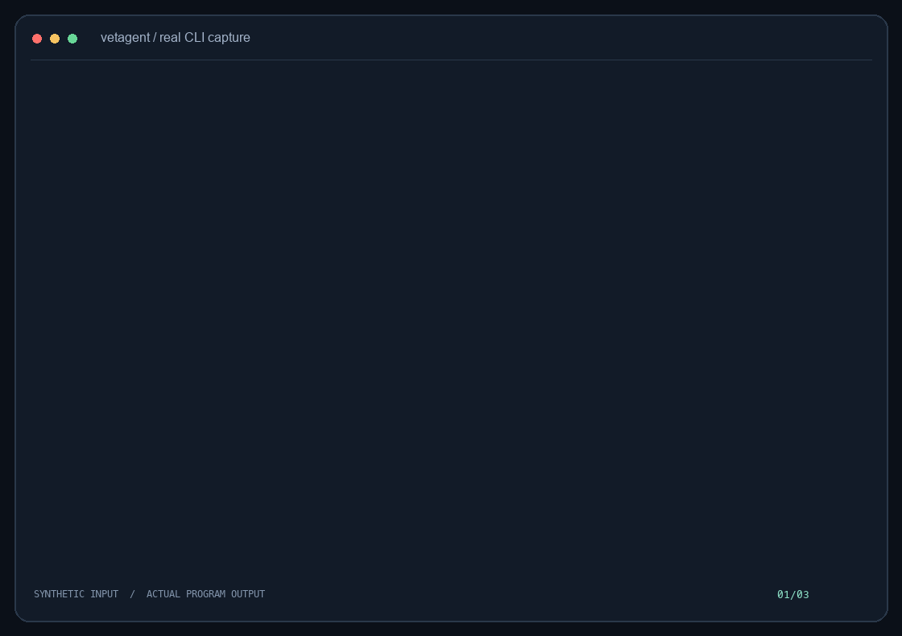
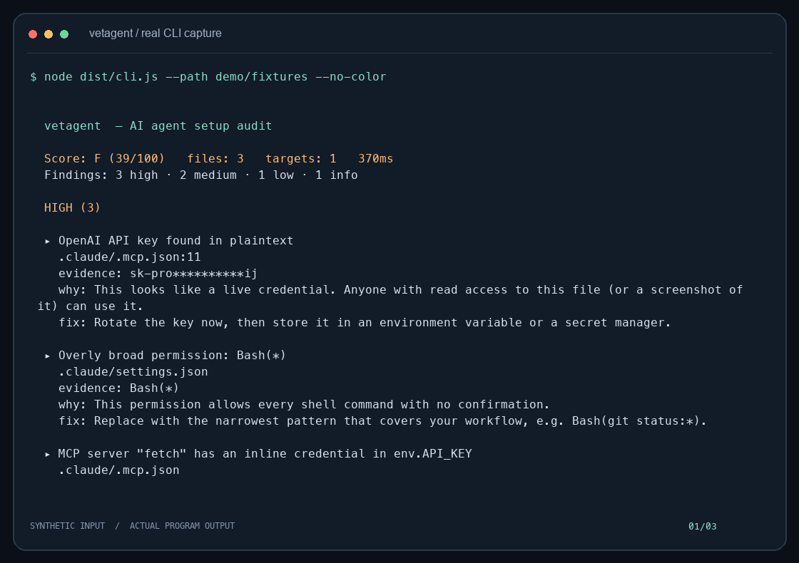
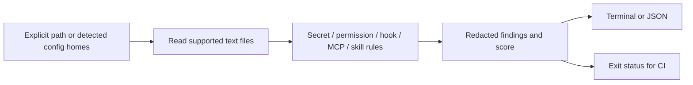

<p align="center"></p>
<h1 align="center">vetagent</h1>
<p align="center"><strong>Review agent configurations before they become execution permissions.</strong></p>

[](https://github.com/LucasXlab/vetagent/actions/workflows/ci.yml) [](LICENSE) [](https://github.com/LucasXlab/vetagent/blob/main/package.json)  [](https://github.com/LucasXlab/vetagent/stargazers)

[English](README.md) · [简体中文](README.zh-CN.md)



The demo is captured from the real CLI using synthetic data. [Transcript](demo/terminal.txt) · regenerate with `python3 scripts/demo.py`.

## Why

Agent configuration mixes credentials, shell permissions, hooks and third-party tools. vetagent reads those files and reports suspicious patterns with locations and suggested fixes, without executing hooks.

| Start with | Good for | Where vetagent helps |
|---|---|---|
| Manual configuration review | Understand local intent | vetagent adds repeatable pattern checks and file locations. |
| A source-code linter | Check language rules | vetagent focuses on agent configuration and permissions. |

## Quick start

```bash
git clone https://github.com/LucasXlab/vetagent.git && cd vetagent
npm ci && npm run build
python3 scripts/demo.py
```

The repository, package metadata and primary executable now use `vetagent`; `agentvet` remains a compatibility executable alias in a local package install. The source build above does not depend on an npm release. A finding exit code of **1** is expected in the bundled demo. Use `node dist/cli.js --path ./my-project` for your own files.

## Features

### Find secret patterns

Look for supported credential formats and private-key blocks; evidence is redacted in reports.

### Review permissions

Flag broad shell permissions, bypass modes and other high-exposure settings.

### Inspect hooks and MCP

Detect patterns such as downloaded shell scripts, unpinned package runners and inline credentials.

### Check instruction files

Inspect skills and agent instructions for risky patterns and hygiene issues. This is pattern matching, not a proof of safety.



## Usage

```bash
node dist/cli.js --path ./my-project
node dist/cli.js --path ./my-project --json
node dist/cli.js --path ./my-project --strict
node dist/cli.js --path ./my-project --exclude "vendor/**"
```

## Architecture



## Privacy and limits

The scanner reads configuration files without application network calls or writes. With no `--path`, it discovers supported agent homes and may read personal configuration. Start with an explicit path. Reports redact matched secret evidence but can still include filenames and other context; review before sharing. Installation downloads development dependencies. See [PRIVACY.md](PRIVACY.md) for data boundaries.

## Development

```bash
npm ci
npm run typecheck
npm run build
npm test
```

The demo uses a temporary fixture and does not inspect your personal repositories or agent homes.

## Roadmap

- [ ] Add accepted-finding baselines.
- [ ] Add SARIF export and more configuration formats.

## Contributing

Read [CONTRIBUTING.md](CONTRIBUTING.md). Report reproducible problems in [Issues](https://github.com/LucasXlab/vetagent/issues). Follow [SECURITY.md](SECURITY.md) for sensitive reports.

## License

[MIT](LICENSE).
