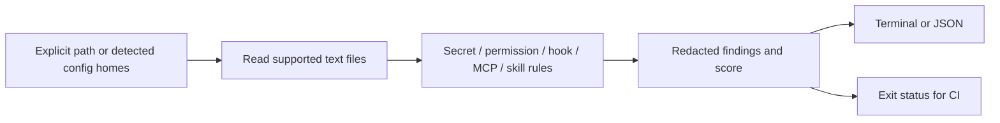

<p align="center"></p>
<h1 align="center">vetagent</h1>
<p align="center"><strong>在代理配置变成实际执行权限之前，先检查它。</strong></p>

[](https://github.com/LucasYanzy/vetagent/actions/workflows/ci.yml) [](LICENSE) [](https://github.com/LucasYanzy/vetagent/blob/main/package.json)  [](https://github.com/LucasYanzy/vetagent/stargazers)

[English](README.md) · [简体中文](README.zh-CN.md)


演示来自真实程序输出，输入全部为合成数据。[终端记录](demo/terminal.txt)；运行 `python3 scripts/demo.py` 可复现。

## 为什么需要它

代理配置混合了凭据、Shell 权限、Hook 与第三方工具。vetagent 读取配置，按位置报告可疑模式和修复建议，不执行其中的 Hook。

## 快速开始

```bash
git clone https://github.com/LucasYanzy/vetagent.git && cd vetagent
npm ci && npm run build
python3 scripts/demo.py
```

仓库、包元数据与主命令统一为 `vetagent`，本地包安装仍保留 `agentvet` 兼容命令。以上从源码运行，不依赖 npm 发布状态。演示有意包含危险配置，返回 **1** 属于预期；检查自己的项目可用 `node dist/cli.js --path ./my-project`。

## 功能

### 凭据模式

检测支持的密钥格式与私钥块；报告中的证据会脱敏。

### 权限检查

标记宽泛 Shell 权限、绕过模式等高暴露配置。

### Hook 与 MCP

检测下载并执行脚本、未固定版本的包执行器、内联凭据等模式。

### 指令文件

检查 Skill 与代理指令中的可疑模式和卫生问题；模式匹配不能证明系统安全。


## 使用

```bash
node dist/cli.js --path ./my-project
node dist/cli.js --path ./my-project --json
node dist/cli.js --path ./my-project --strict
node dist/cli.js --path ./my-project --exclude "vendor/**"
```

## 架构



## 隐私与边界

扫描器仅读配置文件，不写文件，也不发起网络请求。不加 `--path` 时会发现受支持的代理目录，可能读取个人配置；建议先指定路径。报告会脱敏命中的密钥证据，但文件名与上下文仍可能包含敏感信息，分享前请检查。安装开发依赖时需要联网。 详见 [PRIVACY.md](PRIVACY.md)。

## 开发与验证

```bash
npm ci
npm run typecheck
npm run build
npm test
```

演示只使用临时样例，不会扫描你的个人仓库或代理主目录。

## 路线图

请参阅[英文路线图](README.md#roadmap)，其中只列出尚未实现的工作。

## 贡献与许可

贡献方式见 [CONTRIBUTING.md](CONTRIBUTING.md)，安全问题见 [SECURITY.md](SECURITY.md)。采用 [MIT License](LICENSE)。
